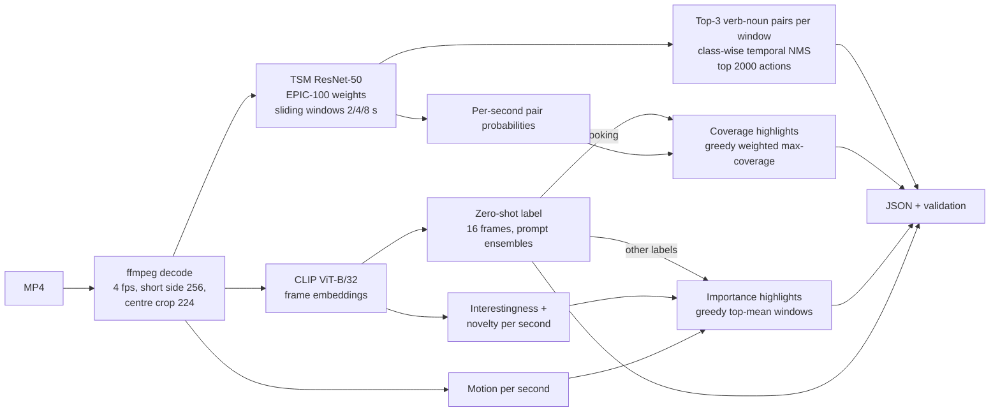

# Action-Aware Video Summarization

Samsung PRISM XR Hackathon 2026, Track 4. Team **Toothpaste Eater** (SRM Institute of Science and Technology).

Given a first-person video, the system recognises fine-grained hand-object actions (verb + noun), predicts the
video category, and selects highlight segments (at most 15% of the video, each at least 4 s) that cover as many
distinct actions as possible. One JSON per video, in the official Track 4 format.

```bash
./run.sh <video.mp4> <out.json>
```

* Demo video (2:57): https://youtu.be/Per1hUIaQKU (copy in [docs/demo/demo_video_720p.mp4](docs/demo/demo_video_720p.mp4))
* AI disclosure: [AI_DISCLOSURE.md](AI_DISCLOSURE.md)
* Presentation: [docs/SRM_ToothpasteEater.pptx](docs/SRM_ToothpasteEater.pptx) ([PDF](docs/SRM_ToothpasteEater.pdf))

## Results

Numbers below are measured on our own runs. The official scores use hidden ground truth we do not have.

| Item | Value |
|---|---|
| Outputs produced | **185 / 187**: EPIC-KITCHENS 138/138, FPVSum 47/49 |
| Validator (`tools/validate.py --dir outputs`) | 185 files, 0 errors, 0 warnings |
| Reproducibility | Docker image on GPU (fp16, no network) vs. GitHub runner on CPU (fp32) for `P01_13`: identical label and highlights, 357/358 identical actions |
| FPVSum label accuracy vs. the category in the file name (development check only, never used by the pipeline) | 39/47 = 0.83 |
| Speed, RTX 3050 6 GB laptop | about 10 s per FPVSum video (2-6 min long); 94 s EPIC video in 20 s |
| Speed, CPU only | about 2x real time |

Two FPVSum videos (`Scuba_KD74Ywuy9ng`, `Scuba_Um4kqB8bQBg`) are private or removed on YouTube, so they could not be
processed; they are listed in `logs/failures.txt`. No output was fabricated for them.

## Pipeline



1. **Decode.** `ffprobe` gives the duration. ffmpeg decodes once at 4 fps to 224x224 RGB crops (NVDEC if available,
   CPU otherwise, PyAV as a fallback).
2. **Actions (TSM).** The official EPIC-KITCHENS-100 TSM RGB checkpoint (ResNet-50 with temporal shift, 8 segments,
   97 verbs + 300 nouns, val action@1 35.75) runs on sliding windows of 2, 4 and 8 s with 1 s stride, 8 frames per
   window, fp16 on GPU. For each window the top-5 verbs x top-5 nouns are scored as p(verb) x p(noun) and the best
   three pairs kept; class-wise temporal NMS (IoU 0.5) across scales, then the top 2000 by score.
3. **Label (CLIP).** OpenCLIP ViT-B/32 (LAION-2B) embeds 16 evenly spaced frames; their mean is compared with
   prompt ensembles for the 16 labels ("a first-person video of skiing down a snowy slope", ...) and soft-maxed.
   The label is predicted from pixels only; file names are never read.
4. **Highlights.** The strategy follows the predicted label:
   * `cooking` (EPIC): weighted max-coverage. Each verb-noun pair seen in the proposals gets a per-second probability
     from the 2 s and 4 s windows; a candidate window (4, 6 or 8 s) covers pair *p* with probability
     q = max over its seconds. Coverage of *p* over the chosen windows is 1 - prod(1 - q). Windows are added greedily
     by coverage gain per second, without overlap, until 14.8% of the duration is used.
   * Other labels (FPVSum): importance(t) = z(CLIP interestingness) + 0.5 z(motion) + 0.5 z(novelty), smoothed;
     the highest-mean non-overlapping 4-8 s windows are picked up to the same budget.
   * Touching segments are merged; every segment is at least 4.0 s. If 15% of the video is under 4 s, one 4.0 s
     segment is output.
5. **Output.** The JSON is validated against all format rules before it is written.

## Repository layout

```
run.sh                    entry point: ./run.sh <video.mp4> <out.json>
code/infer.py             pipeline
code/tsm.py               TSM model definition and strict checkpoint loader
code/clip_model.py        CLIP label, interestingness, novelty
code/highlights.py        coverage / importance highlight selection
code/video_io.py          ffmpeg / PyAV decoding
tools/validate.py         output validator (see note below)
tools/run_batch.py        run a folder of videos with models loaded once
tools/fetch_fpvsum.py     FPVSum download (yt-dlp) with duration check
tools/convert_weights.py  official checkpoint -> fp16 state dict
kaggle/run_epic.py        EPIC batch driver (download, run, delete); used by GitHub Actions and Kaggle
.github/workflows/epic.yml  EPIC batch run on GitHub-hosted runners (20 shards, CPU)
weights/                  tsm_rgb_epic100_fp16.pt (48.9 MB), download_weights.sh
data/                     manifest.csv, supported_classes.json (from the organiser kit)
outputs/                  one JSON per manifest video
```

**Validator note.** The kit README lists a `validate.py`, but it was not in the distributed zip.
`tools/validate.py` re-implements every check the README describes (fields, types, ranges, duration vs. manifest,
vocabulary, highlight ordering/overlap/length/budget) and adds `--expect-all` to require one JSON per manifest video.

## Setup

**Docker (recommended for reproduction)**

```bash
docker build -t track4 .
docker run --rm --gpus all -v /path/to/videos:/data track4 /data/P01_11.MP4 /data/P01_11.json
```

The image (CUDA 12.8, Python, ffmpeg) caches the CLIP weights at build time, so inference needs no network.
It also runs without a GPU (drop `--gpus all`), about 2x real time.

**Local**

```bash
pip install -r requirements.txt --extra-index-url https://download.pytorch.org/whl/cu128
./weights/download_weights.sh      # CLIP into weights/hf; TSM fp16 weights are already in the repo
./run.sh video.mp4 out.json
python tools/validate.py --file out.json -v
```

Environment variables: `TEAM_ID` (default `Toothpaste Eater`), `DECODE_FPS` (4), `TSM_WINDOWS` (`2,4,8`).

## Reproducing all outputs

* **FPVSum (49 videos):** `python tools/fetch_fpvsum.py --videolist <fpvsum repo>/crawler/FPVSum_videolist.csv --out videos/fpvsum`,
  then `python tools/run_batch.py videos/fpvsum outputs/`.
* **EPIC-KITCHENS-100 (138 videos, about 184 GB):** `python kaggle/run_epic.py --shard 0/1 --out outputs/` downloads
  each video with the official `epic-kitchens-download-scripts`, runs the pipeline and deletes the video. We ran it
  as 20 parallel shards with `.github/workflows/epic.yml`. The first pass produced 117 videos; 21 failed
  because of truncated downloads under parallel load or one hung download. Downloads are now checked against the
  official MD5 list, and the 21 were re-run with `-f ids=...`; all 21 then succeeded with verified MD5s.
* `python tools/validate.py --dir outputs/ --expect-all`

## Data and models used

| What | Source | Licence |
|---|---|---|
| EPIC-KITCHENS-100 videos (validation split) | https://epic-kitchens.github.io, official download scripts | CC BY-NC 4.0 |
| FPVSum videos | YouTube ids from https://github.com/azuxmioy/fpvsum | per YouTube uploader |
| TSM RGB checkpoint, EPIC-KITCHENS-100 | https://github.com/epic-kitchens/C1-Action-Recognition-TSN-TRN-TSM | CC BY-NC 4.0 |
| OpenCLIP ViT-B/32, `laion2b_s34b_b79k` | https://github.com/mlfoundations/open_clip | MIT (code), model card on Hugging Face |

No training or fine-tuning was done; no ground-truth annotations were used by the pipeline.

## Credits

* TSM: Lin, Gan, Han. *TSM: Temporal Shift Module for Efficient Video Understanding*, ICCV 2019. The model definition
  in `code/tsm.py` is our own re-implementation written to load the EPIC-KITCHENS checkpoint; the checkpoint itself
  is from the EPIC-KITCHENS team (Damen et al., *Rescaling Egocentric Vision*, IJCV 2022), CC BY-NC 4.0.
* CLIP: Radford et al. 2021; OpenCLIP by Ilharco et al.; LAION-2B weights by Schuhmann et al.
* FPVSum: Ho, Chiu, Wang. *Summarizing First-Person Videos from Third Persons' Points of View*, ECCV 2018.

## Limitations

* Action recognition uses the released TSM model as is; its accuracy (about 36% action top-1 on EPIC-100 val) bounds
  both action mAP and coverage.
* Highlight importance for sports videos is unsupervised (CLIP prompts, motion, novelty); it was not tuned on
  human annotations.
* Zero-shot labels confuse visually similar categories (bike polo vs. bike, plane vs. skydiving).
* Two FPVSum source videos are no longer available on YouTube.

## XR angle

Highlights keep about 15% of the frames, so a downstream XR assistant (captioning, memory, Q&A on smart glasses)
processes roughly 85% fewer visual tokens while keeping most distinct hand-object actions.
